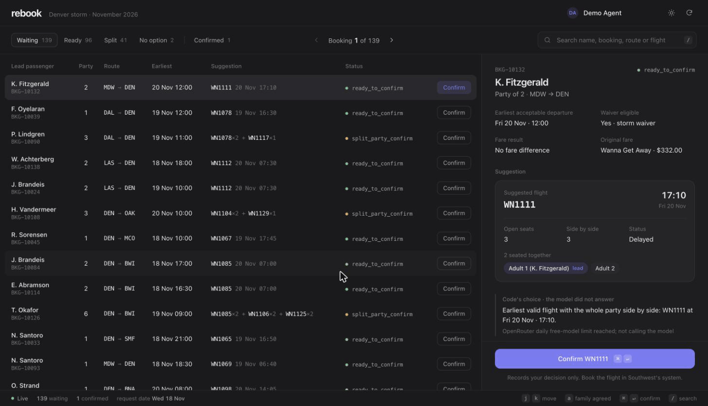
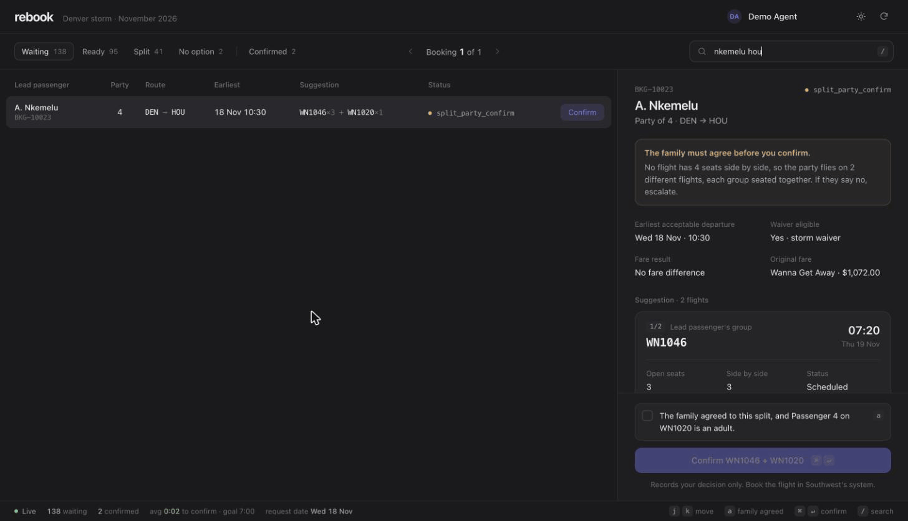
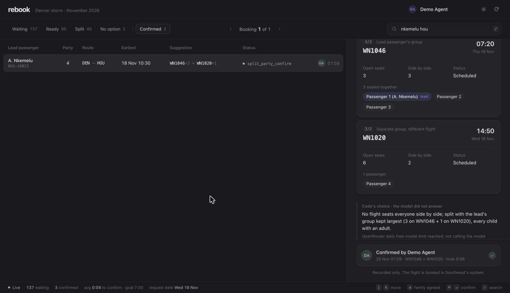
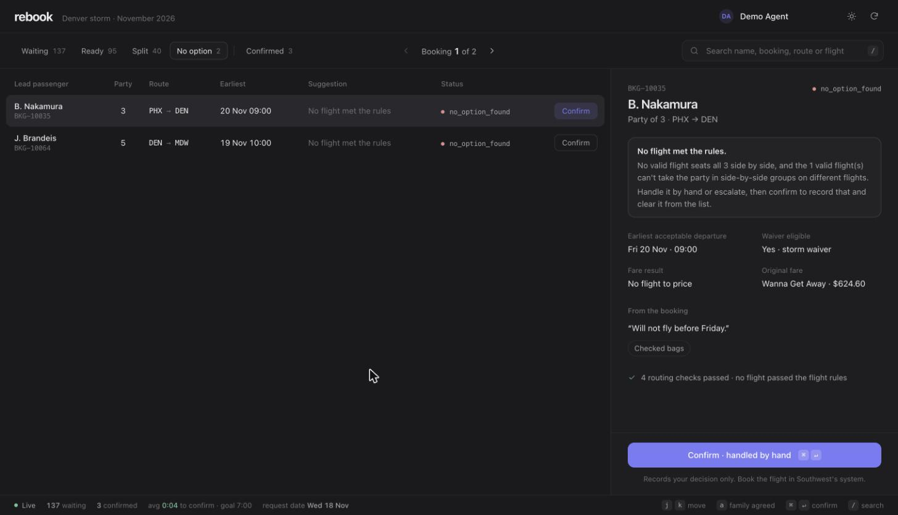

# Denver Storm Rebooking

One screen for the contact-center agents rebooking the itineraries the November 2026 Denver snowstorm cancelled. Every booking arrives with one suggested flight that code has checked against the storm waiver rules. The agent reads it, clicks Confirm, and the next booking opens. The goal is under 7 minutes per itinerary, down from about 14.

**Minutes readout:** [one-page readout (Google Doc)](https://docs.google.com/document/d/1rbDkRzf2yGuapAuQeSoYcntC3FZvU6SkmkLMvhFvoAc/edit?usp=drivesdk) · **Rules:** [REBOOKING_SPEC.md](REBOOKING_SPEC.md), the SPEC.md the acceptance criteria refer to

## Open, check, confirm



Every booking still waiting is one row, newest cancellation first, with its one suggestion and its `suggestion_status`. Opening a booking puts the flight, the open seats, the fare result and the model's one-line reason beside the list. Confirm records the decision and opens the next booking. It never books the flight; that still happens in Southwest's system.

## The family of four



No flight has four seats side by side, so the party is split. The lead passenger and two others sit together on WN1046, and the fourth flies on WN1020, a different flight that passes the same rules. The page says the family must agree, and Confirm stays off until the agent ticks that they did.



<sub>BKG-10023 (A. Nkemelu, DEN → HOU), confirmed and labelled `split_party_confirm`. Recorded on the real data by a scripted browser signed in as "Demo Agent", so the times on screen are seconds, not an agent's. The free model's daily limit was used up, so this split shows the code's reason.</sub>

## No flight met the rules



A `no_option_found` booking still opens, says why in plain words and keeps the agent note in view. Confirm records that the agent handled it by hand or escalated it, so every row can be decided without leaving the page.

<sub>2 of the 140 bookings: BKG-10035 and BKG-10064.</sub>

## Timed from open to Confirm

The page times each booking from the moment the agent first opens it to the click on Confirm, and stores the seconds with the confirmation. The status bar shows the average against the 7-minute goal, and the Confirmed filter lists every booking with who confirmed it, when, and how long it took. It is the same clock the acceptance run uses, written down per itinerary as it happens.

## How it works

1. Code runs the routing checks and the flight rules from the spec: departure at or after `earliest_acceptable_departure`, not cancelled, enough open seats, and the storm waiver only where `waiver_eligible` is true. What's left is a short list of valid options, either the whole party together or side-by-side groups on different flights. ([rules.py](app/rules.py), [options.py](app/options.py))
2. A free OpenRouter model picks one option by its ID and writes a one-line reason. It answers in JSON and has no way to add a flight. ([ai.py](app/ai.py))
3. Code re-checks the pick against every rule. If the reply is malformed or the pick fails a rule, the code's best option is used and the page says so. ([service.py](app/service.py))
4. Confirm writes who, when, which flights and the seconds taken to the Supabase `confirmations` table. Nothing is booked. ([main.py](app/main.py))

A split keeps the lead passenger's group the largest and every child with an adult, and never puts more people on a flight than it has open seats.

## On the real data

All 140 cancelled bookings, request date 18 Nov 2026:

| `suggestion_status` | Bookings |
| --- | --- |
| `ready_to_confirm` | 96 |
| `split_party_confirm` | 42, of which 21 also ask the agent to confirm the separate group is adults |
| `no_option_found` | 2 |

Every suggestion passes every rule check ([test_end_to_end.py](tests/test_end_to_end.py)). All 7 parties of four whose best flight has three seats side by side come out as three plus one on two different flights. The six bookings the waiver doesn't cover keep their original fare rules: four are quoted the difference to collect, two owe nothing.

## Built with Claude Code

The key instruction given to Claude Code for the page:

> "Build the agent page (React + Vite, in /web). One screen, no second page or tab … For split_party_confirm: show the three passengers seated together (with the lead passenger named) on one flight, and the fourth passenger's flight_no and departure_datetime. Show a clear note that the family must agree before confirming. A no_option_found booking still opens and states plainly that no flight met the rules. No empty panels and no spinners that never end. … Keep it fast to scan. Agents will be timed opening and confirming each booking."

## Changes to the AI's output

- **Rejected** Claude Code's first split rule. It kept the family of four's fourth passenger on the three-seat flight, seated apart from the others, which the split party rule fails. The fourth passenger now goes on a different valid flight ([test_family_of_four.py](tests/test_family_of_four.py)).
- **Changed** the list, which cut off the Confirm column on screens narrower than about 1290px, so an agent on a laptop had to scroll sideways to confirm. The booking id now sits under the name, and every column fits down to 1084px.

## Run it

Needs Python 3.11+ and Node.js 20+.

```bash
./run.sh app     # rebooking service on :8000, agent page on http://localhost:5173
```

The first run creates `.venv`, installs everything and copies `.env.example` to `.env`. The other modes:

```bash
./run.sh         # tests, load both CSVs into Supabase, the family-of-four demo, the summary
./run.sh serve   # service only, API docs at http://127.0.0.1:8000/docs
./run.sh page    # page only (the service must be running)
./run.sh reset   # clear every confirmation, so all bookings are waiting again
```

The values `.env` needs, by name only (`.env` is git-ignored):

| Name | What |
| --- | --- |
| `SUPABASE_URL` | Supabase project URL |
| `SUPABASE_SERVICE_ROLE_KEY` | Supabase service-role key, used server side only |
| `SUPABASE_DB_URL` | Optional Postgres URL, so `./run.sh` can create the tables (needs `psql`) |
| `OPENROUTER_API_KEY` | OpenRouter key |
| `OPENROUTER_MODEL` | OpenRouter model id. Empty means `nvidia/nemotron-3-ultra-550b-a55b:free` |
| `REQUEST_DATE` | Date the rebooking is requested, `2026-11-18` in `.env.example` |

Without the Supabase values the service reads `data/*.csv` and keeps confirmations in memory.

## Known limits

- A free OpenRouter key allows about 50 model calls a day, and the list needs 138. Each reply is cached, so a booking is asked once; until then its row shows the code's choice and says so. Adding $10 of OpenRouter credit raises the limit to 1,000 a day.
- Party make-up comes from free-text agent notes. When it isn't stated, ticking "the family agreed" also confirms the separate passenger is an adult.
- Direct flights only.
- Onward connections, weather risk and requests in the notes are shown to the agent and the model, not enforced by code.

## Code

```
app/      rebooking service (FastAPI): rules, options, ai, service, fares, party, db, main
web/      agent page (React + Vite)
db/       schema.sql: bookings, passengers, flights, confirmations
scripts/  seed, the family-of-four demo, the summary over the real data
tests/    rules, the family of four, confirm, no_option_found, the full run
```

API: `GET /suggestions`, `GET /confirmations`, `GET /suggestions/{booking_id}` and `POST /bookings/{booking_id}/confirm`.

---

**More.** The rules and their open questions: [REBOOKING_SPEC.md](REBOOKING_SPEC.md). The prompt behind the spec: [PROMPT_NOTES.md](PROMPT_NOTES.md).

Python, FastAPI, Supabase, React and Vite. The model runs on OpenRouter, `nvidia/nemotron-3-ultra-550b-a55b:free` by default.

Built by [@fuyofulo](https://github.com/fuyofulo).
